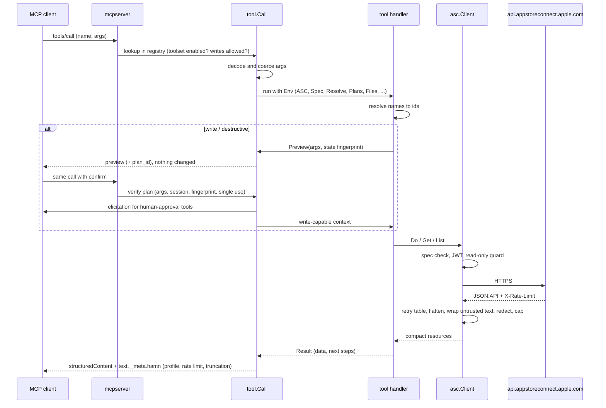

# Architecture

hamn is one Go binary with no runtime dependencies. It uses the official MCP Go SDK, the standard library for HTTP, JWTs and money, and a pinned index of Apple's OpenAPI spec. Every tool is declared once in a registry, and the server, the docs and the tests all read from that registry.

## Package map

| Package | Role |
|---|---|
| `cmd/hamn` | CLI: `serve` (default), `auth`, `doctor`, `config`, `skills`, `version` |
| `cmd/hamn-record` | Dev-only (`-tags dev`) fixture recorder: GET-only, sanitized |
| `internal/tool` | The contract: `Meta`, `Class`, `Toolset`, `ConfirmMode`, `Env`, `Result`, the registry, the confirm gate |
| `internal/tool/tooltest` | Test kit: fake ASC client, fake planner and resolver, `Call`, goldens |
| `internal/tools/*` | One package per toolset; each `init()` registers its tools. `all` links them in |
| `internal/tools/docsgen` | `go generate` target that writes `docs/TOOLS.md` and `docs/tools.json` |
| `internal/mcpserver` | Builds the MCP server from the registry: toolsets, read-only withholding, plans, elicitation, resources, prompts, stdio and HTTP transports |
| `internal/app` | Wires config, credentials, client, spec, state and confined files into a `tool.Env` |
| `internal/config` | Profiles, project pins, environment, modes, file permission checks |
| `internal/auth` | ES256 JWTs (team and individual keys), token cache, keychain and file key sources |
| `internal/asc` | The App Store Connect client: retries, rate limit, pagination, cursors, error hints, compaction, byte cap, redaction, untrusted wrapping, read-only guard, unauthenticated fetcher with URL policy |
| `internal/ascrules` | Shared Apple behavior rules, e.g. which 409s mean "already done" |
| `internal/resolve` | Turns `"Hjul"`, `"latest"`, `"German"` or a bundle id into ids for apps, versions, builds, locales and groups |
| `internal/spec` | Embedded spec index (`index.json.gz`), search, describe, validate; `gen/` builds the index from Apple's zip |
| `internal/applemeta` | Apple tables: display types and pixel sizes, locales, field limits, report columns |
| `internal/metadata` | Listing pull, diff and apply; fastlane and Expo formats |
| `internal/reports` | Gzip and TSV decoding with limits, typed rows, exact money, aggregation |
| `internal/upload` | Asset uploads and build uploads: reserve, PUT parts, commit, poll, resume |
| `internal/state` | Cursors and upload resume records in the XDG state dir |
| `internal/asctest` | Fake ASC server that checks every request against the spec |
| `skills/` | Embedded agent skills (`hamn skills install`) |
| `test/live` | Read-only smoke test against the real API (`make smoke`) |
| `test/jobs` | End-to-end "agent jobs" through the MCP protocol against fakes |

## Request flow

## Spec index

Apple publishes the App Store Connect OpenAPI spec as a zip. `internal/spec/gen` reads `openapi.oas*.json` and writes a compact gzipped index (operations, params, enums, request body skeletons, free-text attributes, sensitive operations) plus `PROVENANCE.json` with the spec's hashes. The index is embedded in the binary.

It powers:

- `asc_api_search` and `asc_api_describe`;
- validation of every `asc_api_get` / `asc_api_request` call before Apple sees it (a mismatch returns the problems and a body skeleton);
- error hints with valid enum values;
- which attributes count as untrusted free text;
- contract tests: the fake server rejects any request that is not in the spec.

A weekly workflow (`spec-drift.yml`) downloads the latest spec, regenerates the index and opens a PR when it changed.

Regenerate by hand: `HAMN_SPEC=/path/to/openapi.oas.json go generate ./internal/spec`.

## Results and context budget

- JSON:API is flattened to `{id, type, ...attributes, rel}`; per-resource links are dropped.
- Results are compact JSON, capped at `HAMN_MAX_RESPONSE_BYTES` (60 KB): `included` goes first, then tail items, with a `_truncated` note.
- `_meta.hamn` carries the profile, the rate limit left this hour and truncation details.
- Tool descriptions are short and enums live in schemas. A test fails if the default `tools/list` gets too big.

## Testing strategy

- **Unit tests** for pure pieces: retry table, JWT, cursor validation (fuzzed), TSV and gzip decoding (fuzzed), money, compaction and cap, redaction, char limits, display table, plan fingerprints.
- **Tool tests** run each tool through `tooltest` against a fake ASC client or `asctest` server. Every request is validated against the spec. Outputs are compared with goldens (`go test ./... -update` rewrites them).
- **Protocol tests** in `internal/mcpserver`: `tools/list` snapshot, class and annotation consistency, read-only withholding, discovery mode, `list_changed`, budget caps, plan/confirm, elicitation decline, HTTP token and Origin checks.
- **Job tests** in `test/jobs` drive multi-step agent flows over MCP.
- **Live smoke** (`make smoke`, build tag `live`): real key, read-only, a transport guard that refuses any non-GET.
