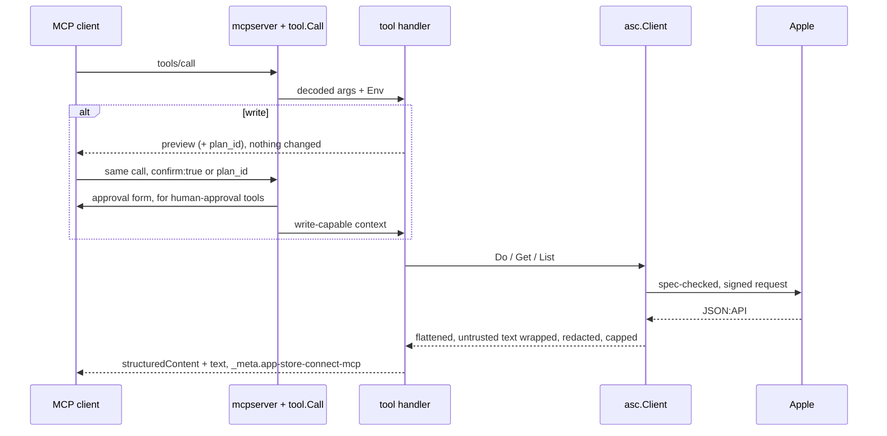

# Architecture

One Go binary on the official MCP Go SDK and a pinned index of Apple's OpenAPI spec. Each tool is declared once in a registry, and the server, the docs and the tests all read from it.

## Packages

| Package | Job |
|---|---|
| `cmd/app-store-connect-mcp` | CLI: `serve`, `auth`, `doctor`, `config`, `skills`, `guard`, `aso`, `version` |
| `cmd/app-store-connect-mcp-record` | Dev-only fixture recorder (`-tags dev`), GET-only |
| `internal/tool` | The contract: tool meta, classes, toolsets, confirm gate, registry. `tooltest` is its test kit |
| `internal/tools/*` | One package per toolset. `docsgen` writes `docs/TOOLS.md` and `docs/tools.json` |
| `internal/mcpserver` | Registry to MCP: toolsets, read-only hiding, plans, approvals, resources, prompts, stdio and HTTP |
| `internal/app` | Wires config, keys, client, spec, state and files into a `tool.Env` |
| `internal/config`, `internal/auth` | Profiles, pins, env; ES256 JWTs, token cache, keychain |
| `internal/asc` | The API client: retries, rate limit, pagination, error hints, compaction, caps, redaction, write guard, URL policy |
| `internal/ascrules`, `internal/resolve` | Apple quirks; turning "Hjul" or "latest" into ids |
| `internal/spec` | Embedded spec index, search, describe, validate; `gen/` builds it |
| `internal/applemeta`, `internal/metadata`, `internal/reports`, `internal/upload`, `internal/state` | Apple tables, listing diffs, report decoding, uploads, cursors |
| `internal/asctest` | Fake ASC server that rejects anything not in the spec |
| `skills/`, `test/live`, `test/jobs` | Agent skills, read-only smoke test, end-to-end agent flows |

## A tool call

## Spec index

`internal/spec/gen` turns Apple's `openapi.oas*.json` into a gzipped index plus `PROVENANCE.json`, embedded in the binary. It feeds `asc_api_search` and `asc_api_describe`, validates raw API calls before Apple sees them, supplies enum hints and the list of free-text fields, and lets the fake server reject made-up requests. `spec-drift.yml` checks for a new spec weekly and opens a PR.

By hand: `ASC_MCP_SPEC=/path/to/openapi.oas.json make spec`.

## Tests

Unit tests for the pure bits, with fuzzing for cursors and report decoding. Tool tests run through `tooltest` against the spec-checking fake and compare goldens (`-update` rewrites them). Protocol tests in `internal/mcpserver` cover `tools/list`, read-only hiding, plans, approvals, HTTP checks and the context budget. `make smoke` hits the real API, read-only.
